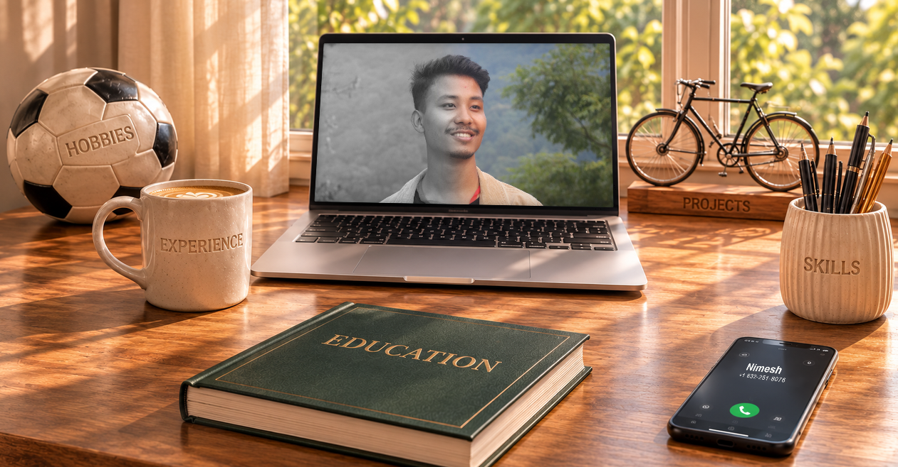

# Interactive Portfolio Workspace

A full-screen React/Vite portfolio homepage built around a photographic desk scene. The desk photograph is the full-bleed background; the printed objects are interactive navigation targets.

## Run locally

```bash
npm install
npm run dev
```

### Screenshots




## How it is built

- `src/sceneData.js` holds the geometry: the scene size (the photo's native 1672 x 941), the four corners of the laptop display, and a traced silhouette for every object.
- `src/geometry.js` turns those corners into a CSS `matrix3d()` so the wallpaper is warped onto the display's perspective instead of sitting on it as a flat rectangle.
- The photo, wallpaper, hover effects and click targets all live in one fixed-size scene that is scaled together to cover the viewport, so the wallpaper stays locked to the laptop at every screen size.
- Each object's click target is its own traced silhouette (the laptop's covers the whole laptop). Shapes no longer overlap, so clicking anywhere on the mug, including its base, opens Experience.

## Interaction details

Hovering (or keyboard-focusing) an object lights it softly: a gentle bloom on the object, a faint warm halo, and a very light dimming of everything else. The laptop screen also brightens slightly, as if waking. Nothing moves or scales, so neighbouring objects are never disturbed, and all of it is opacity-driven and disabled under `prefers-reduced-motion`. Touch taps open sections directly without leaving a stuck hover state.


